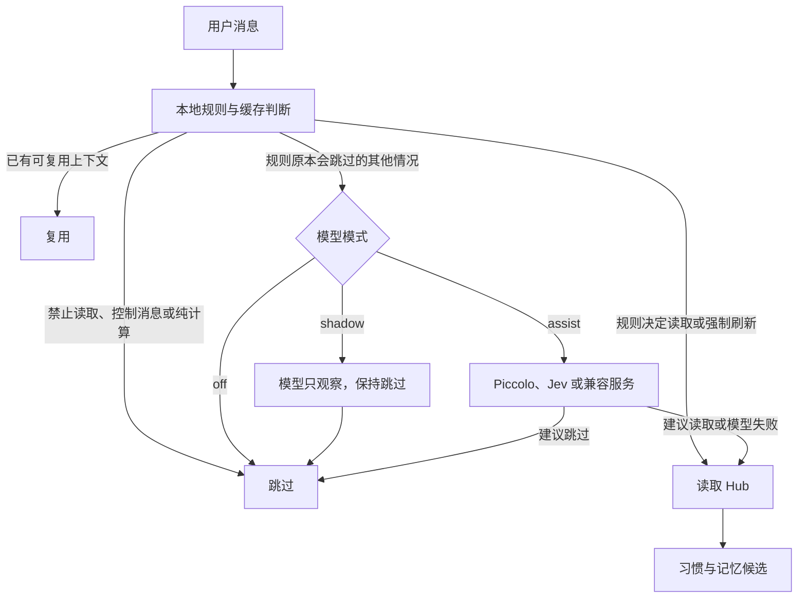

# Memory Gate：读取与写入建议试点

## 当前实现

`echome gate decide` 是独立的 shadow 判断入口，支持本地规则、Piccolo、Kev、Laya、Jev，以及 `chat_completions` 兼容服务。
它只返回建议，不检索 Hub、不创建记忆、不执行建议。
另有显式安装的 `echome hook` Codex 适配器，负责让新任务进入轻量判断；仅部署模型服务或运行 Gate 不会自动安装它。

## 自动读取 Gate 架构基线

以下是 2026-11-27 的源码方案；是否已安装、启用或部署须另查运行环境。



规则先判断“是否强制刷新记忆”，再判断读取、复用或跳过：重新读取记忆、使用刚更新的偏好可以触发强刷；重新检查 Git 或重算文件校验值本身不会。强刷绕过相关缓存；一般任务仍按规则判断是否读取。用户明确禁止读取优先；仅否定旧记忆而另行要求读取新记忆时，按新请求处理。

模型只补充规则原本会跳过的读取，不否决规则已决定的读取。`assist` 下模型超时、响应不合法或概率低时保守尝试读取；Hub 失败或超出总预算仍可能没有结果。模型输入是规范化后的当前消息及可选项目短名，不包含检索出的记忆正文；在线服务会收到这些输入。

实现入口：[`hook_entry.py`](../echome/hook_entry.py) 读取配置，[`hook_freshness.py`](../echome/core/hook_freshness.py) 判断刷新，[`task_hook.py`](../echome/core/task_hook.py) 管理读取和缓存，[`memory_gate.py`](../echome/core/memory_gate.py) 连接模型，[`piccolo_server.py`](../echome/piccolo_server.py) 提供可选本机服务。当前 Hook 的模型概率阈值为 0.5，单次超时 1.8 秒，总预算 3.5 秒；`chat_completions` 不提供概率时不适用该阈值。

升级时保留“用户禁止读取优先、模型不能否决规则读取、模型故障保守兜底”的边界。替换模型或调整规则、阈值后，使用新的独立真实样本比较漏读、额外读取、延迟和最终有用记忆，并分别验证关闭、超时和不可用。现有小样本只支持判断层面的初步结论，基线与限制见 [Hook Gate 本机评测](evals/hook-gate-20261127.md)。

## Codex 自动入口（Linux / macOS 试点）

```bash
echome hook install
echome hook status
# 退出试点时，只移除 EchoMe 自有 handler
echome hook remove
```

安装器合并 `~/.codex/hooks.json`，保留现有 Hook，修改前备份。默认优先使用独立的 `echome-hook` 启动程序，避免加载交互 CLI；旧环境可回退到 `echome`。它不修改 Codex 的信任记录；安装后须在同一主机、同一用户的 Codex CLI 中输入 `/hooks`，审核并信任新增的 EchoMe handler。配置存在不等于已经信任或实际执行。其他客户端尚未自动安装入口。

原生加载验收需先确认 `/hooks` 没有配置解析错误，并能列出 EchoMe 的两个 handler；再检查信任状态及正常会话的实际触发。手工运行 `echome-hook`、安装器显示 `complete=true` 都不能替代这一步。生成的 `timeout` 必须为整数秒，浮点数 `5.0` 会被 Codex 拒绝。

- `SessionStart` 只重置该会话的元数据状态，恢复、压缩和分叉后不假设先前注入仍在上下文。
- `UserPromptSubmit` 先检查敏感输入、用户禁止读取和是否明确要求刷新记忆。规则判断需读取的任务直接查询；模型只可补充规则原本会跳过的任务，不能否决已有的规则读取。纯控制消息和独立数字计算不调用模型。
- 检索前只清理已知客户端附带的 browser/open-page/environment 包装，问答回复保留问题与回答；用户 URL、实体、代码示例和未知标签不删除。原始输入先限 64 KiB，再对有效任务检查 4,000 字符上限，避免页面附带文本改变任务和缓存身份。
- 完全相同的已交付请求和有先前交付的短“继续”复用；新任务不因为同属一个领域就被当成已有上下文。完全相同的空结果只缓存 60 秒，过期后重查。明确刷新记忆或使用刚更新的习惯、偏好时绕过缓存；重新检查 Git、重算文件校验值等不单独触发记忆强刷。规则无法确定但存在记忆刷新线索时保守强刷；复杂引述、否定和跨句指代仍可能判断错误。“请刷新记忆”本身也触发读取。状态按账户、会话和工作目录区分，成功及空结果各最多保存 32 个任务哈希，一小时整体失效。
- 习惯卡通过标签筛选读取，绕过全文语义碰运气。首版只自动加载 active、纯全局且无项目排除条件的习惯；支持 `trigger:web`、`trigger:always`，兼容既有“适用时机：Web 项目...”格式。最多三张、2,500 字符预算，长卡只给明确的展开引用，不截掉“不要做”或例外。
- Web 预览/交付习惯需要页面、样式、控件改动、故障症状或明确预览/应用域名交付意图；前端 manifest 仅作辅助，不因身处 Web 仓库就把预览卡带给网络、建模或日志任务。其他通用记忆检索不因此跳过。目录检查不执行项目脚本，当前用户指令始终优先。
- 只有完整习惯目录中的所有可自动使用版本都已交付，本会话才可在 60 秒内省去重复习惯请求；尚未适用、未投递、列表不完整或读取失败时不缓存覆盖状态。没有更新提示的新卡至多到该短 TTL 后再核对；明确刷新可立即重读。只注入尚未交付或版本变化的卡片。
- 普通经验和知识通过一次 `POST /api/v1/context/discovery` 获取候选索引，附 cwd 和有界本地读取的安全 Git origin；不执行 Git、不读取 include 或发送 URL 凭据。只认已登记项目身份，未知/冲突线索退回个人库，不猜项目或创建别名。已解析项目纳入该项目及历史别名作用域的记忆，并给出完整项目上下文的展开入口；不执行完整 compiler/preflight。
- 自动发现过滤无主题支撑的宽泛操作词及弱向量命中，同时保留强语义同义召回。明确查询记忆/历史配置保留宽召回，普通显式 MCP 检索不受自动过滤影响。空索引不能证明没有有用记忆；当前对话、完整习惯和主 AI 主动检索仍可使用。索引不代表已读全文或完整约束包，策略警示及知识争议状态随引用保留。
- discovery 始终不记 run、不写记忆、不自动报 outcome。状态文件只保存哈希、版本、时间、决策/请求计数及本次处理耗时/输出字符数，不保存任务正文、卡片正文、Token 或完整聊天。`habit_failure` 和 `discovery_dropped` 分别记录可选习惯读取失败及输出未交付；计数可重叠。`last_execution.latency_ms` 不包含 Python 进程启动；缓存重置后的计数不能当作全天统计。
- 适配器总预算 3.5 秒，Hook 上限 5 秒；模型单次预算 1.8 秒，无重试、不跟随重定向。模型不可用时，`assist` 对原本准备跳过的模糊任务保守尝试读取；如果总预算或 Hub 失败，本轮仍可能没有记忆，主任务继续。默认不调用任何模型。

更新时先部署支持 discovery 的 Hub，再更新客户端。旧 Hub 返回 404 时客户端记 `discovery_not_supported` 并放行，不追加一次完整上下文请求；独立习惯读取仍可工作。源码修复及本地候选回放不等同于正在运行的 Hub/Hook 已更新。

可选模型使用 `ECHOME_HOOK_GATE_PROVIDER`、`ECHOME_HOOK_GATE_URL`、`ECHOME_HOOK_GATE_MODEL` 选择；凭据使用对应 provider 的独立环境变量，安装器不写入凭据。`ECHOME_HOOK_GATE_MODE` 有三个主要选项：

- `off`：不调用模型，只运行本地规则。`ECHOME_HOOK_GATE_PROVIDER=rules` 同样关闭模型。
- `shadow`：仅观察规则原本会跳过的任务，记录模型建议，不改变读取结果。
- `assist`：模型建议 `retrieve` 时补充读取；建议 `skip` 只维持原有跳过，故障时保守读取。规则原本要读取的任务不调用模型，也不会被模型否决。

未设置 mode 时使用 `legacy` 兼容先前可选模型行为；默认 provider 仍为 `rules`，因此不调用模型。要启用新行为须显式设置 `shadow` 或 `assist`。

例如，启动本机 Piccolo 服务后，在启动 Codex 的环境中设置：

```bash
export ECHOME_HOOK_GATE_PROVIDER=piccolo
export ECHOME_HOOK_GATE_URL=http://127.0.0.1:18643
export ECHOME_HOOK_GATE_MODE=assist  # 或 shadow；off 关闭模型
```

切换至在线 Jev 时显式设置以下配置，模型版本可按需要替换：

```bash
export ECHOME_HOOK_GATE_PROVIDER=jev
export ECHOME_HOOK_GATE_URL=https://api.typesafe.ai
export ECHOME_HOOK_GATE_MODEL=jev-1.14.0
export ECHOME_HOOK_GATE_MODE=assist
# 在受保护的进程环境中设置 ECHOME_GATE_JEV_API_KEY；不要写入命令历史或项目文件。
```

在线模式会向指定服务发送规范化后的当前用户消息和项目短名，不发送记忆正文；常见凭据检查不能代替完整脱敏。没有显式设置 provider、地址和 Jev 独立密钥时不会访问 Jev。修改环境变量后应确保运行 Hook 的 Codex 进程实际继承了它们。

### 可选的本机 Piccolo 服务

在单独的 Python 环境安装已下载模型目录中 `requirements.txt` 所需依赖后运行：

```bash
python -m echome.piccolo_server --model-dir /data/models/Piccolo-4B --device cuda:0 --port 18643
```

服务只绑定 `127.0.0.1`，提供 `/health` 和单问题 Choice 的 `/v1/systemone`；启动时加载并预热，GPU 忙时立即返回错误，由 Hook 安全兜底。它使用模型发布文件内的 `flex_twice`、双向 attention 和候选 token 读出，不把 Piccolo 当普通聊天模型。`--dtype auto` 在支持原生 BF16 的 CUDA 设备上使用 BF16，否则在 CUDA 上使用 FP16、CPU 上使用 FP32；具体精度与设备的效果需要单独验证。模型及其 tokenizer、配置和下载缓存仍放 `/data/models`；服务依赖不加入 EchoMe 基础依赖。

这是有限规则的客户端试点，不保证识别所有隐含历史需求；保留主 AI 主动查询的入口。

这个 Gate 判断“当前任务是否需要交互”；Hub 的 Context Policy 判断“检索出的内容是否适合提供”。两者各自保留，不互相替代。

## 输入与输出

通过标准输入或 `--input request.json` 提供 JSON：

```json
{
  "schema_version": "echome.memory-gate.v1",
  "phase": "read",
  "text": "给记忆服务设计一个兼容当前部署的接入方案。",
  "project_hint": "EchoMe",
  "context_available": false,
  "explicit_action": "auto"
}
```

- `phase`：`read` 或 `write`。输入应为短任务描述或待评估的用户陈述，不能把整个对话或记忆库塞进去。正文最多 4,000 字符，JSON 输入最多 64 KiB；服务还有独立 token 限制，过长会降级。
- `explicit_action`：`auto`、`read`、`remember`、`skip`；`read` 只用于读取阶段，`remember` 只用于写入阶段。显式意图优先于模型，但不能绕过敏感信息拦截。
- `context_available`：调用方确认已有适用上下文时才设为 true。Gate 不验证缓存、项目身份或时效；历史信息有变化时调用方必须失效缓存。明确恢复历史的请求仍可要求检索。
- `project_hint`：可选的短项目标识，同样接受敏感信息检查。

读取建议为 `retrieve`（检索）、`reuse`（复用）或 `skip`；写入建议为 `propose`（生成待审提案）、`review`（意图不清需复核）或 `skip`。`propose` 不代表可直接写入。

回执包含 `decision_id`、`phase`、`action`、`provider`、`reason_code`、`model_action`、`model_probability`、`latency_ms`、`degraded` 和固定的 `shadow: true`。`provider` 是实际决策来源，规则命中时为 `rules`。模型低概率回退仍保留原始 `model_action`，便于区分模型效果和兜底效果。概率尚未校准，不能理解为正确率。

## 使用

```bash
# 只用规则，完全不需要判断服务
echome gate decide --input request.json

# 在调用进程环境中设置 ECHOME_GATE_API_KEY，不把密钥放进命令参数或仓库
echome gate decide --input request.json \
  --provider kev --base-url http://127.0.0.1:18641 \
  --audit ~/.echome/gate/events.jsonl --event-id task-123

echome gate decide --input request.json \
  --provider laya --base-url http://127.0.0.1:18642

# Piccolo 需要预先启动本机服务
echome gate decide --input request.json \
  --provider piccolo --base-url http://127.0.0.1:18643

# Jev 需单独配置 ECHOME_GATE_JEV_API_KEY，再显式指定服务地址
echome gate decide --input request.json \
  --provider jev --base-url https://api.typesafe.ai

# 支持 JSON 输出的本地或远程 Chat Completions 服务
# 密钥仅通过 ECHOME_GATE_CHAT_API_KEY 设置；本机无鉴权服务可不设
echome gate decide --input request.json \
  --provider chat_completions --base-url http://127.0.0.1:8000/v1 \
  --model YOUR_SERVED_MODEL
```

Piccolo/Kev/Laya/Jev 使用 `POST /v1/systemone`，也支持以 `/v1` 结尾的 base URL。`--model` 可覆盖默认模型 ID；内置 Piccolo 服务接受 `piccolo-4b`。没有读取 Hub token 或自动发现其他服务凭据的逻辑，`--api-key-env` 可指定独立环境变量名。Jev 默认只读 `ECHOME_GATE_JEV_API_KEY`，Piccolo 只读 `ECHOME_GATE_PICCOLO_API_KEY`，Kev/Laya 使用 `ECHOME_GATE_API_KEY`；内置 Piccolo 服务不需要密钥，Jev 缺少地址或密钥时直接本地回退。

`chat_completions` 使用 `/v1/chat/completions`，要求显式模型 ID 和服务地址，并支持 `response_format: json_object`。只接受完整的 `{"action":"retrieve"}` 等合法分类 JSON，不接受工具调用、解释段落或自报 confidence；因此 `model_probability` 为 null。读取阶段的 skip 仅作观察，不自动阻止检索。其专用密钥为 `ECHOME_GATE_CHAT_API_KEY`，无 SDK 新依赖；本机无鉴权服务可留空。协议测试不代表任何具体模型的真实任务准确率。

默认阈值 0.8、总超时 2 秒；概率低、429/503、超时、非法标签或分布等均回退为读取 `retrieve` / 写入 `review`。不重试，不跟随重定向，不使用 HTTP 代理环境变量。HTTP 仅接受 localhost、loopback 或私网 IP，其他显式配置的服务需 HTTPS。

正文与项目提示中常见密钥、密码赋值、私钥、Bearer、`sshpass -p` 等会在模型请求前被拦截；这是常见凭据检测，并非完整数据脱敏。调用方仍应限制输入为必要的任务摘要。

可选审计只记录决策元数据，不记录任务正文、项目提示、访问密钥或服务错误正文。文件必须属于当前用户、权限 600 且为普通文件，拒绝符号链接。`event-id` 用于关联调用方任务，不提供去重保证；不要用正文或凭据充当 ID。

## Jev 接入边界（2026-10-22）

Jev 是 TypeSafe 的判断模型；当前官方接口接受 `state`、`model` 和命名的 `questions`，Choice 返回选项及其概率分布。EchoMe 直接复用现有 HTTP 协议，无需新增 SDK。[官方 API](https://docs.typesafe.ai/api/system-one)

本节中的默认阈值、超时和返回建议描述独立的 `echome gate decide`；自动 Hook 的模式、阈值和超时以前文为准。

新增 provider 名为 `jev`，与既有 `kev` 分开。默认固定为 `jev-1.13.0`，避免稳定别名升级后无声改变判断；需要其他版本时通过 `--model` 显式指定。2026-10-22 核对时，官方 `jev-latest` 指向 1.13.0、`jev-preview` 指向 1.14.0。[官方模型列表](https://docs.typesafe.ai/models)

- 默认仍是 `rules`，不联网、不下载模型、不增加每轮 MCP 调用。
- 显式配置 Jev 后，仅在规则无法判断时发送短任务摘要；沿用敏感信息拦截、2 秒总超时、零重试。
- Jev 读取建议为 `skip` 时，仅记录 `model_action: skip` 和概率，`action` 保持 `retrieve`，理由为 `model_skip_shadow_only`。未验证的判断不能阻止需要的记忆读取；用户显式跳过与明确独立任务仍按本地规则处理。
- 写入仍只是 `propose/review/skip` 建议，不调用 Hub，不自动写入，不向用户发起确认。任务是否调用 Gate 由客户端选择，已有可用上下文可以直接复用。
- 阈值仍针对所选选项的概率；不把 API 的派生 `confidence` 当作另一次质量验证。[官方说明](https://docs.typesafe.ai/confidence)

此接入仅通过模拟 API 的协议和失败边界测试，尚无 Jev 的真实任务准确率或延迟实测。现有 Kev/Laya 报告不代表 Jev；其历史评测脚本仍只比较原有三个 provider。正式决定是否用 Jev 减少检索前，须单独评估中文任务的漏读率与额外延迟。

## 评测与选型

源码仓库包含 60 条合成中文用例（读取/写入各 30），其中 48 条为语义判断、12 条为显式控制和安全边界。它们不是实际用户对话，不代表生产流量分布；开发者自标注的 `dev` / `holdout` 分组也不等于独立盲测。

```bash
# 设置 ECHOME_GATE_KEV_API_KEY 和 ECHOME_GATE_LAYA_API_KEY 后执行
uv run python scripts/eval_memory_gate.py \
  --provider rules --provider kev --provider laya \
  --output /tmp/memory-gate-eval.json

# 只比较原始模型，检查选项位置敏感性
uv run python scripts/eval_memory_gate.py \
  --provider kev --provider laya --mode model --reverse-options \
  --output /tmp/memory-gate-reversed.json
```

脚本串行交错请求两个模型，避免并发冲击。`model` 模式绕过业务规则和概率阈值，仅对非敏感合成语义用例测原始分类；`gate` 模式测试完整判断链，包括兜底。报告分别统计读取漏判、误建议写入、有效模型预测数、错误、降级和延迟；报告保留用例 ID、文件哈希和单请求提示哈希，不包含原文或密钥。超时/接口错误计入总样本分母，不会虚增准确率。

实测报告见 [Kev / Laya 中文对比](memory-gate-evaluation.md)。第一版只观察建议，模型选型不能绕过上线验收。

## 推进顺序

| 优先级 | 工作 | 可验收结果 |
|---|---|---|
| P0 | 修复 context 交付预算 | 长记忆不会挤掉所有短记忆；完整硬约束保留；正文和索引分开计量 |
| P0 | 统一 Gate 与合成评测 | 同一协议比较规则/Kev/Laya；无记忆读写副作用；错误可追踪 |
| P1 | Codex 客户端入口试点已实现，待实际使用评估 | 可安装、撤销，记录不含正文的决策计数；后续评估有效正文与实际使用，避免把索引交付当成功使用 |
| P1 | 真实任务人工标注与校准 | 取得调用覆盖率、漏读/误提案、额外延迟，比较规则基线与模型；用新的留出集复核 |
| P2 | 小范围自动读取 | 保留显式读取与故障兜底；按项目/任务身份复用缓存；可一键退回规则 |
| P2 | 独立记忆提案箱 | 去重、关联来源、旧事实更正、反馈分流、敏感检查；审核后才入库 |
| P3 | 有条件的受控写入 | 按验收结果逐类开放，保留可撤销记录与审计 |

客户端入口必须通过其实际支持的 Hook 或外层启动器接入；只在 Hub 或 MCP 内增加模型，无法发现客户端从未发起的任务。当前仅实现本地 Codex 适配，其他客户端需分别接入并验收，不因 MCP 更新而自动生效。

当前 `ai_review` 记忆已经可以参与检索，不能拿它当隔离的提案箱；shadow 输出不得自动转换为 `echome_remember`。现有来源、审核、Sleep 保护规则继续适用。

## Context 预算交付变化

compact 输出先压缩重复的策略诊断，再按原相关性顺序尝试放入完整记录；放不下的大记录不会阻挡后面的短记录。constraints、guardrail、L0、must_include、冲突与完成契约仍完整保留，保护内容本身超限会返回 `OUTPUT_BUDGET_TOO_SMALL`。

`preflight.requirements` 中与顶层完整约束的 ID、版本、正文和限定一致的条目使用 `context_ref: "#/constraints/N"` 引用同响应内正文，不要求另一次请求。不同版本、独有预检规则、警示正文及证据仍完整保留；full 响应不变。约束本身大于总预算时仍显式报错，不能靠丢规则消除错误。

当没有可交付的可选记忆正文时，尽量提供 `memory_index`，仅包含 ID、标题和 `needs_expansion: true`（必要时含策略干预标记）；按 `GET /api/v1/memories/{id}` 展开后才能使用。索引不是摘要，更不代表已获取完整规则，只有索引不能声称 `supported`。

`token_used` 保留编译预算含义；新增 `compiled_content_tokens`、`delivered_content_tokens`、`memory_index_tokens` 分开描述编译正文、交付正文和引用索引的估算。最终 JSON 硬上限仍以保守的 UTF-8 字节测量，不把这些估算混作实际模型 tokenizer 计费。ContextRun 的 `selected` 只计完整交付条目，索引 ID 单列到 trace；full 保留详细诊断。
